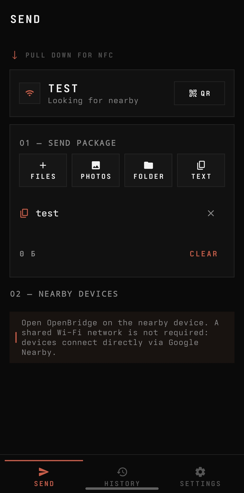
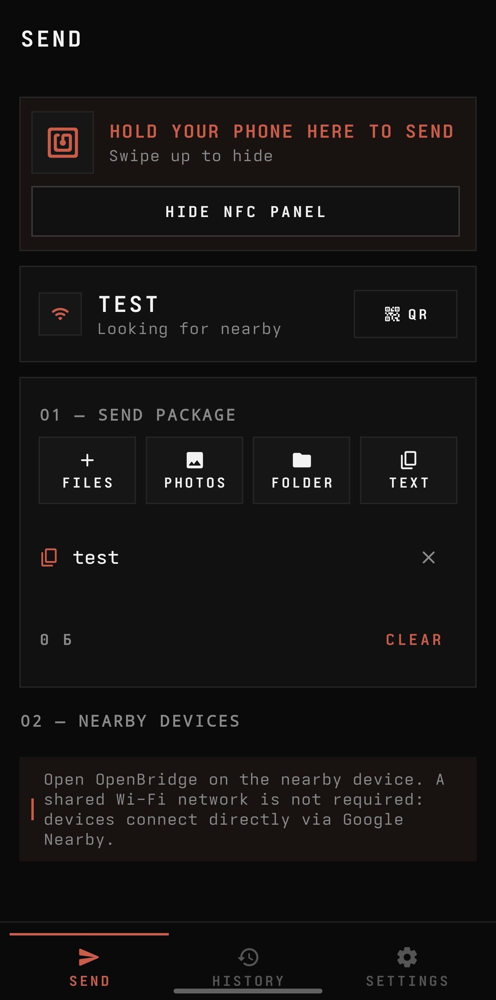
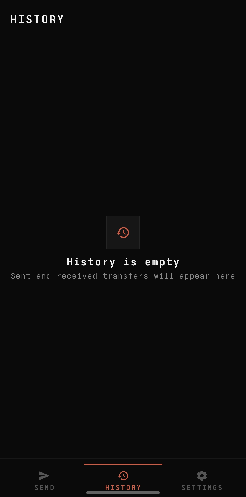
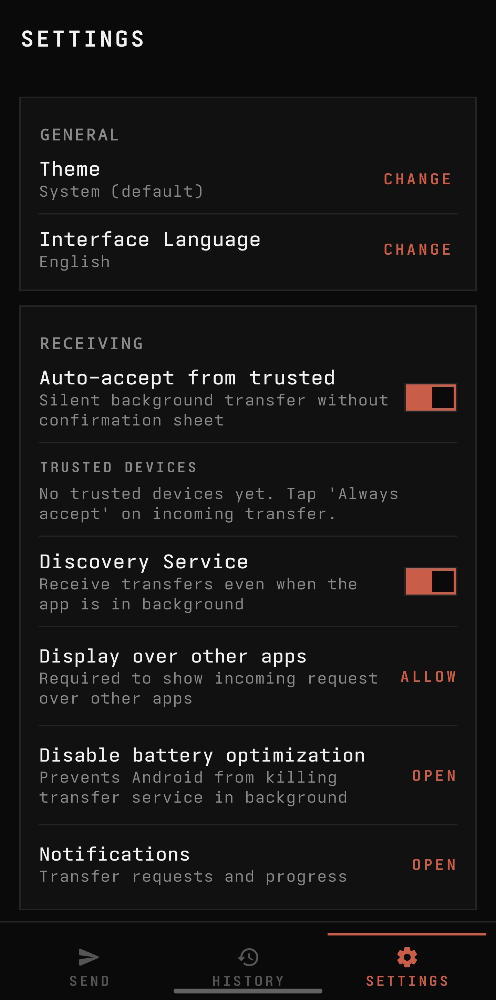

<div align="center">


# OpenBridge

Direct device-to-device sharing. No internet, no cloud, no accounts.

[](https://github.com/TheLuFik1112/OpenBridge/releases)
[](https://developer.android.com)
[](https://kotlinlang.org)
[](LICENSE)

**English** · [Русский](README.ru.md)

</div>

## Overview

OpenBridge moves files, photos, folders and text between Android devices over the local network or a direct Google Nearby connection. Nothing passes through the internet, a cloud service or an account. If there is no router around, the phones still find each other and transfer directly.

## Features

- **Package-first sending** — collect files, photos, folders or text, then choose the recipient.
- **NFC in one tap** — swipe down on the Send screen and hold two phones together.
- **QR browser sharing** — open the package on a PC or iPhone with no app installed.
- **Works without a router** — LAN when available, Google Nearby when there is no network.
- **Receiving in the background** — discovery keeps running, requests appear over other apps, trusted devices are accepted automatically.
- **Flat technical UI** — dark and light palettes, system theme by default, Russian and English.
- **Quick Settings tile** — send the clipboard in one tap.
- **Resumable transfers** — an interrupted transfer continues from where it stopped.

## Screenshots

<table align="center">
  <tr>
    <td align="center"></td>
    <td align="center"></td>
  </tr>
  <tr>
    <td align="center"></td>
    <td align="center"></td>
  </tr>
</table>

## Installation

1. Download the latest `OpenBridge-*.apk` from [Releases](https://github.com/TheLuFik1112/OpenBridge/releases/latest).
2. Open the file on the device and allow installation from this source.
3. Grant the permissions the app asks for: notifications, nearby devices and storage.

Android 8.0 or newer is required.

## Building from source

Requirements: JDK 17 and Android SDK 35.

```bash
git clone https://github.com/TheLuFik1112/OpenBridge.git
cd OpenBridge
./gradlew assembleRelease
```

The APK is written to `app/build/outputs/apk/release/`.

## License

Distributed under the [MIT License](LICENSE).
