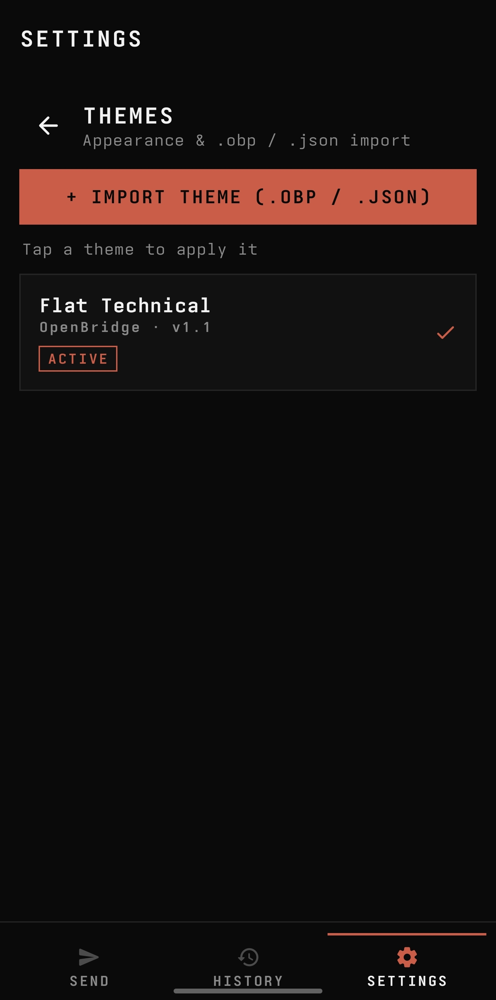
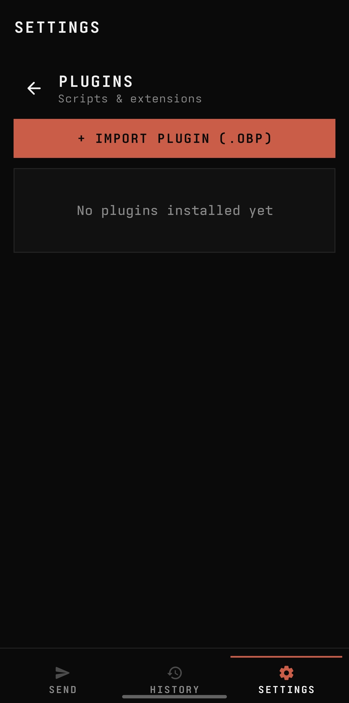

<div align="center">


# OpenBridge

Прямая передача с устройства на устройство. Без интернета, облака и аккаунтов.

[](https://github.com/TheLuFik1112/OpenBridge/releases)
[](https://developer.android.com)
[](https://kotlinlang.org)
[](LICENSE)

[Скачать последний APK](https://github.com/TheLuFik1112/OpenBridge/releases/latest)

[English](README.md) · **Русский**

</div>

## Обзор

OpenBridge передаёт файлы, фото, папки и текст между Android-устройствами по локальной сети или через прямое соединение Google Nearby. Данные не проходят через интернет, облачные сервисы и аккаунты. Если роутера рядом нет, телефоны всё равно находят друг друга и передают напрямую.

## Возможности

- **Сначала пакет** — соберите файлы, фото, папки или текст, затем выберите получателя.
- **NFC в одно касание** — свайп вниз на экране отправки и телефоны друг к другу. В метке лежит обычная ссылка на GitHub, поэтому телефон без OpenBridge откроет страницу в браузере, а не ошибку.
- **QR для браузера** — откройте пакет на ПК или iPhone без установки приложения.
- **Работает без роутера** — LAN при наличии сети, Google Nearby без неё.
- **Приём в фоне** — поиск не останавливается, запросы показываются поверх других приложений, доверенные устройства принимаются автоматически.
- **Темы** — импорт файла `.json` или архива `.obp` со своими цветами, скруглениями, стилями элементов и шрифтом `.ttf`.
- **Скриптовые плагины** — архив `.obp` с `manifest.json` и `main.js`, небольшие JavaScript-хуки на полученный и отправленный текст и файлы.
- **Плоский технический интерфейс** — тёмная и светлая палитры, системная тема по умолчанию, русский и английский языки.
- **Плитка быстрых настроек** — отправка буфера обмена в один тап.
- **Докачка** — прерванная передача продолжается с того же места.

## Темы и плагины

В настройках есть отдельные разделы для тем и плагинов. И то и другое ставится из файла, root и сторонние приложения не нужны.

Тема — это JSON-объект: цвета для тёмной и светлой схемы, скругления, стили кнопок и переключателей, вид нижней панели и, при желании, свой шрифт. Импортируется файл `.json` или архив `.obp` с `theme.json` и шрифтом `.ttf` или `.otf` рядом.

Скриптовый плагин — архив `.obp` с `manifest.json` и файлом JavaScript. Ему доступны три хука — `onTextReceived`, `onFileReceived` и `onTransferSent` — и небольшой объект `ob`: открыть ссылку, скопировать в буфер, показать сообщение, записать в Logcat, проиграть анимацию на экране и включить вибрацию. Каждый хук получает транспорт (`lan`, `nearby`, `nfc`, `qr`). Плагин работает в песочнице без доступа к файлам, сети и Android API.

Оба формата и все поля описаны в [docs/PLUGINS.ru.md](docs/PLUGINS.ru.md).

## Скриншоты

<table align="center">
  <tr>
    <td align="center"></td>
    <td align="center"></td>
  </tr>
  <tr>
    <td align="center"></td>
    <td align="center"></td>
  </tr>
</table>

## Установка

1. Скачайте свежий `OpenBridge-*.apk` из [Releases](https://github.com/TheLuFik1112/OpenBridge/releases/latest).
2. Откройте файл на телефоне и разрешите установку из этого источника.
3. Выдайте разрешения, которые попросит приложение: уведомления, устройства рядом, память.

Требуется Android 8.0 или новее.

## Сборка из исходников

Нужны JDK 17 и Android SDK 35.

```bash
git clone https://github.com/TheLuFik1112/OpenBridge.git
cd OpenBridge
./gradlew assembleRelease
```

APK появится в `app/build/outputs/apk/release/`.

## Лицензия

Распространяется под [лицензией MIT](LICENSE).
