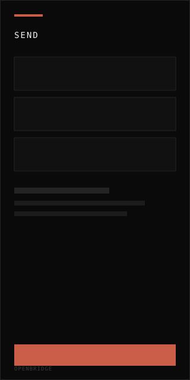
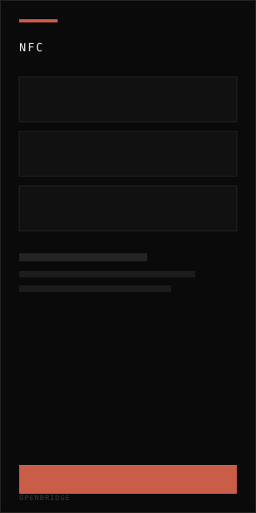
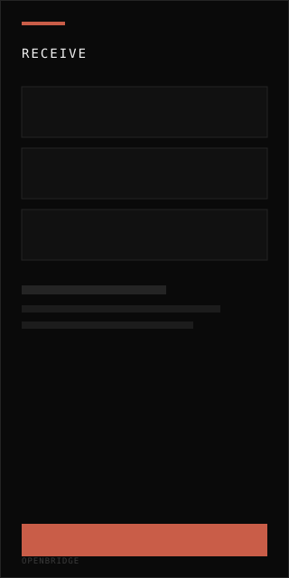
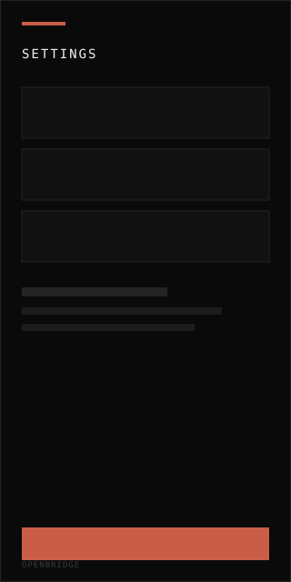

<div align="center">


# OpenBridge

Прямая передача с устройства на устройство. Без интернета, облака и аккаунтов.

[](../../releases)
[](https://developer.android.com)
[](https://kotlinlang.org)
[](LICENSE)

[English](README.md) · **Русский**

</div>

## Обзор

OpenBridge передаёт файлы, фото, папки и текст между Android-устройствами по локальной сети или через прямое соединение Google Nearby. Данные не проходят через интернет, облачные сервисы и аккаунты. Если роутера рядом нет, телефоны всё равно находят друг друга и передают напрямую.

## Возможности

- **Сначала пакет** — соберите файлы, фото, папки или текст, затем выберите получателя.
- **NFC в одно касание** — свайп вниз на экране отправки и телефоны друг к другу.
- **QR для браузера** — откройте пакет на ПК или iPhone без установки приложения.
- **Работает без роутера** — LAN при наличии сети, Google Nearby без неё.
- **Приём в фоне** — поиск не останавливается, запросы показываются поверх других приложений, доверенные устройства принимаются автоматически.
- **Плоский технический интерфейс** — тёмная и светлая палитры, системная тема по умолчанию, русский и английский языки.
- **Плитка быстрых настроек** — отправка буфера обмена в один тап.
- **Докачка** — прерванная передача продолжается с того же места.

## Скриншоты

<p align="center">
  
  
  
  
</p>

Замените заглушки в [`docs/screenshots`](docs/screenshots) настоящими скриншотами, когда они будут готовы.

## Установка

1. Скачайте свежий `OpenBridge-*.apk` из [Releases](../../releases/latest).
2. Откройте файл на телефоне и разрешите установку из этого источника.
3. Выдайте разрешения, которые попросит приложение: уведомления, устройства рядом, память.

Требуется Android 8.0 или новее.

## Сборка из исходников

Нужны JDK 17 и Android SDK 35.

```bash
git clone https://github.com/TheLuFik1112/OpenBridge.git
cd OpenBridge
./gradlew assembleRelease
```

APK появится в `app/build/outputs/apk/release/`.

## Лицензия

Распространяется под [лицензией MIT](LICENSE).
